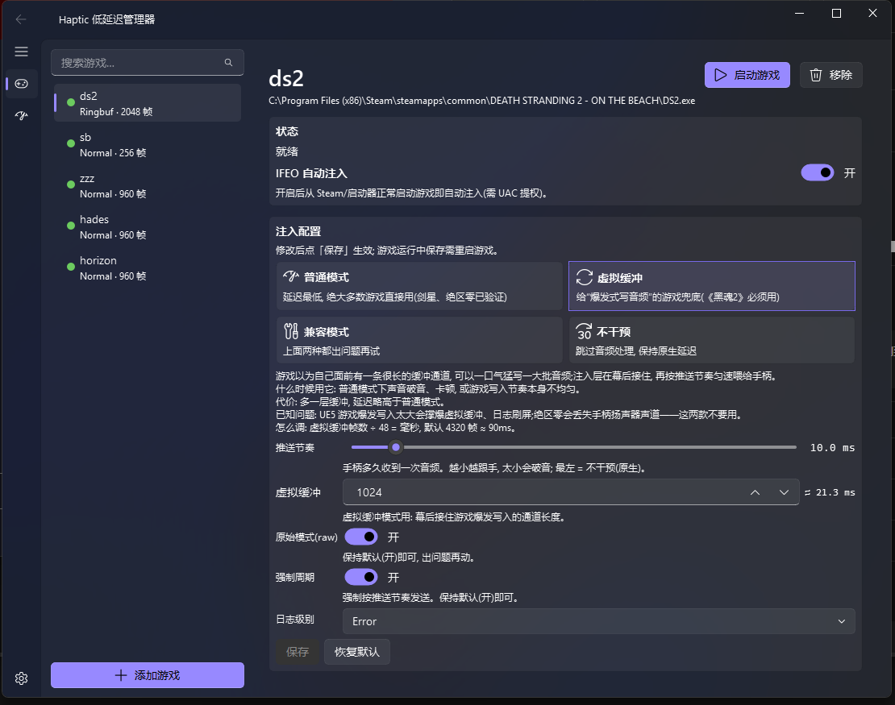
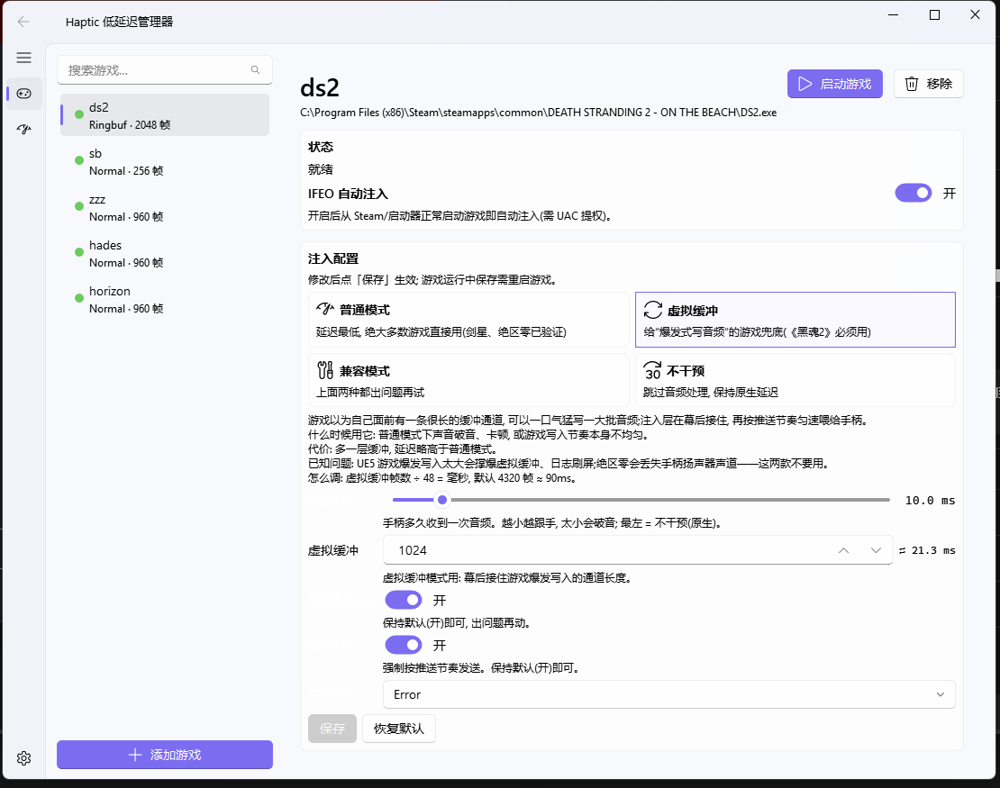

# HapticImproveManager

中文 | [English](README_EN.md)

DualSense 触觉(haptic)低延迟注入系统的可视化管理器 — 把 PC 游戏写给手柄的
haptic 音频缓冲从原生 20–85ms 压到 ~10ms,用图形界面管理整个注入链路。



<details>
<summary>浅色主题截图</summary>


</details>

## 功能

- **游戏中心**:左侧游戏列表(状态点 + 搜索),右侧详情页,选中即上下文——
  状态徽章、IFEO 自动注入开关、启动游戏、注入配置都归属于当前游戏
- **注入配置通俗化**:四种模式(普通 / 虚拟缓冲 / 兼容 / 不干预)卡片式单选,
  每项配置带白话说明,缓冲帧数实时换算毫秒,不适用当前模式的项自动隐藏
- **添加游戏向导**:选择 exe → 反作弊特征检测(HoYoKProtect/EAC/BattlEye 风险提示)
  → 生成 `redirect_config.toml` → 一键开启 IFEO
- **诊断页**:最近注入结果 + `injector_debug.log` / `wasapi_relink.log` 尾随监视,
  一键在资源管理器中打开
- **设置页**:浅色 / 深色 / 跟随系统主题,Mica 云母背景,日志目录可更改并
  批量同步到所有已注册游戏
- **多语言**:设置页切换 跟随系统 / 中文 / English,重启应用后生效

## 安装与运行

### 方式一:下载成品(推荐)

从 [Releases](../../releases) 下载 `HapticImproveManager.zip`,解压后双击
`HapticImproveManager.exe`(整目录拷走才可用,勿只拷 exe)。

> 零依赖,解压即用:注入链已随包冻结分发——`chain/` 下的 `injector.exe`、
> `haptic_launcher.exe` 与 `zzz_inject/wasapi_relink.dll`,无需安装 Python
> 或任何外部依赖。

> **从 ≤v0.2.0 升级**:请对每个游戏重新开关一次 IFEO(先关再开)。旧版写入
> 注册表的 pythonw 调试器值与新版不匹配,游戏状态会显示「IFEO 被其他调试器
> 占用」,重开即修复。

### 方式二:源码运行

要求 Windows 10/11 + Python 3.11+:

```bash
python -m pip install -r requirements.txt
python app.py
```

## 工作原理

PC 游戏把 DualSense haptic 渲染成音频流,经 WASAPI 共享模式送入手柄音频端点
(4 声道:ch1/2 = 扬声器,ch3/4 = haptic 马达)。游戏申请的音频缓冲
(20–85ms)是 haptic 延迟的主要来源。

本工具随包分发的注入链(`chain/` 下的 `injector.exe` / `haptic_launcher.exe`,
源码在 specialk 项目继续开发、构建期冻结)把
[wasapi_relink](https://github.com/Litttlefish/wasapi_relink) DLL 注入游戏进程,
在 WASAPI 层面压缩缓冲、约束写入节奏。本 GUI 负责游戏注册、配置编辑
(`redirect_config.toml`)、IFEO 自动注入管理与日志诊断。

## 架构

薄 GUI(PySide6 + [PySide6-Fluent-Widgets](https://github.com/zhiyiYo/PySide6-Fluent-Widgets))
+ 子进程后端。GUI 普通权限运行;IFEO 开关由 launcher 自行 UAC 提权。

- 注入链随包冻结在 `chain/` 目录:`injector.exe`(IFEO 拉起,无窗)、
  `haptic_launcher.exe`(GUI 子进程)、`zzz_inject/wasapi_relink.dll`;
  `games.yaml` 与注入日志运行时写入该目录
- 游戏注册表 `games.yaml` 由 GUI 与 CLI 共用
- `ui/config_model.py` 是表单 ↔ TOML 的纯函数映射(可单测,保留注释)
- GUI 设置(主题 / 日志目录)存 `%APPDATA%/HapticImproveManager/gui_config.json`
- 设计与实现文档见 `docs/superpowers/`

## 测试

```bash
python -m pytest tests/ -v
```

## 自行打包 exe

```cmd
packaging\build_exe.bat
```

产出 `dist\HapticImproveManager\`(onedir 模式,含 `chain\` 注入链)。链源码
路径是脚本顶部的 `SPECIALK` 常量(仅构建期依赖,运行时不需要),按需修改。
脚本在构建失败时会明确报 `[FAIL]`(例如 exe 正在运行导致 `dist\` 被占用)。
